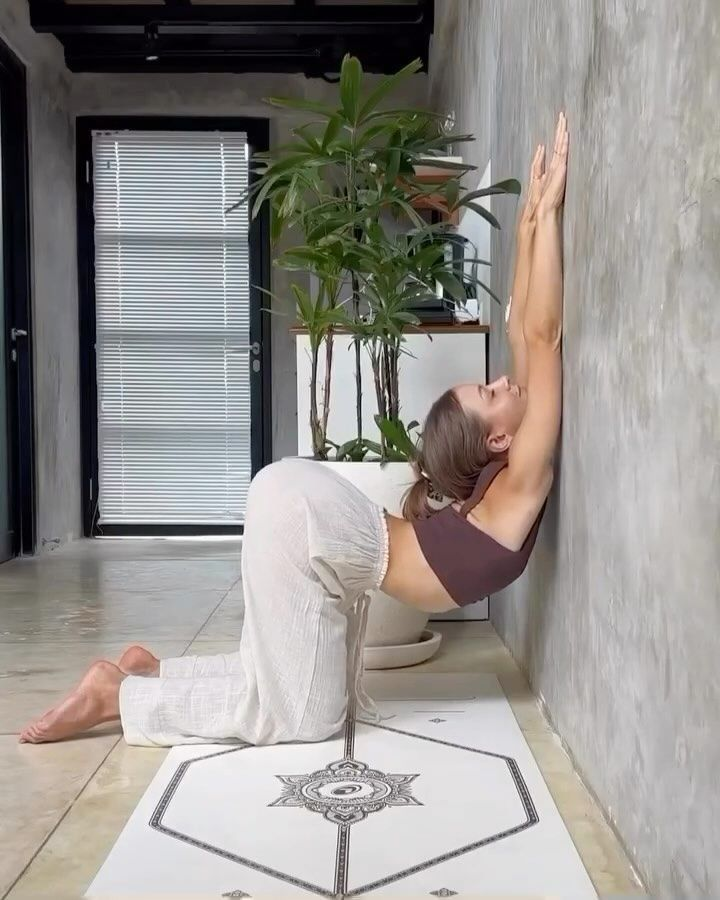

If you have ever searched for a place to start with yoga, you have probably seen the word hatha. It appears on studio timetables, in app libraries and in books, and it can seem vague. Is hatha a style, a level, or a general label? The short answer is that hatha yoga is the broad branch of yoga built around physical postures, breathing and relaxation, and in practice a hatha class is usually slow, steady and beginner-friendly. That makes it one of the best ways to learn the basics.

This guide explains what hatha yoga is, what a typical class feels like, what you need to start, and how to practice ten foundational poses safely. It finishes with a 30-minute routine you can do at home, a list of common mistakes, and a short section on who should take extra care.

## What hatha yoga actually is

Yoga is an ancient practice rooted in Indian philosophy. According to the U.S. National Center for Complementary and Integrative Health (NCCIH), it began as a spiritual practice and has become popular as a way of promoting physical and mental well-being. Yoga as it is usually practiced in the United States, they note, emphasizes physical postures (asanas), breathing techniques (pranayama) and meditation.

Hatha is a general term for the physical side of yoga. In many classes, "hatha" simply signals a gentle to moderate pace, with poses held for several breaths rather than flowing continuously from one to the next. Many popular styles, including Iyengar and Ashtanga, grew out of the hatha tradition, but a class labeled hatha is usually slower and less structured than those.

In a typical hatha class you can expect:

- **A short opening** where the teacher may ask you to sit, breathe and settle your attention
- **Warm-up movements** such as gentle spinal motion and shoulder rolls
- **Standing poses** that build strength and balance
- **Floor poses** for flexibility, including seated forward folds and gentle twists
- **A final relaxation,** usually lying on your back for several minutes

Most classes last 45 to 90 minutes, according to MedlinePlus, and all styles include three basic components: poses, breathing and meditation or relaxation.

## Why beginners often start with hatha

There are a few reasons this style suits newcomers:

1. **The pace is slow.** Holding a pose for five breaths gives you time to understand it, notice how it feels and adjust.
2. **Poses are simplified.** Teachers commonly offer modifications and use props such as blocks and straps.
3. **There is no performance.** You are not expected to look like a photo. The goal is to feel the pose, not to reach a shape.
4. **It teaches the vocabulary.** The poses you learn in hatha show up in nearly every other style.

## What the research says (and does not say)

Yoga is widely studied, but the research is mixed in quality, and honest reporting matters. The NCCIH says studies suggest possible benefits for stress management, mental and emotional health, healthy habits, sleep and balance. For low-back pain, it notes that yoga has shown promising results and is among the options the American College of Physicians recommends as first-line treatment for chronic low-back pain, although a 2022 review found yoga was only slightly better than no exercise and that the small difference may not matter much to patients.

The NCCIH also stresses that different yoga styles make comparison difficult, and that "in most instances, we can only say that yoga has shown promise for particular health uses, not that it's been proven to help." Treat any claim that yoga cures a disease with caution. A sensible expectation is that regular, gentle practice may help you feel more flexible, calmer and stronger, as with other forms of moderate exercise.

## What you need to start

You do not need much:

- **A yoga mat,** or a non-slip surface. A thin mat is fine for most poses
- **Comfortable clothing** that lets you move freely
- **A quiet space** about the size of your mat plus a little room on each side
- **Optional props:** two yoga blocks (or sturdy books), a strap (or a belt), a folded blanket and a bolster or firm pillow
- **A glass of water** nearby

Avoid practicing right after a large meal. Many people prefer to wait a couple of hours.

## Safety rules for beginners

Yoga is generally considered safe for healthy people when practiced appropriately, but you can get hurt. The NCCIH notes that learning yoga on your own without supervision has been associated with increased risks, and it recommends practicing under a qualified instructor to reduce injury risk. If you practice at home, take these precautions:

- **Start slowly,** and learn the basics before pushing yourself, as MedlinePlus advises
- **Never push into pain.** A stretch should feel like gentle tension, not sharp or pinching pain
- **Listen to your body.** If you feel pain or fatigue, stop and rest
- **Use props.** They are a sign of intelligent practice, not weakness
- **Warm up first,** with a few minutes of easy movement
- **Tell a professional about health conditions.** If you have a medical condition or injury, or are pregnant, talk to a health care provider first and ask which poses to avoid

MedlinePlus lists several conditions where poses may need to be avoided or modified, including pregnancy, high blood pressure, glaucoma, sciatica and arthritis.

## Breathing basics

Breath is not an extra in yoga. It is part of the practice. For hatha yoga, a simple approach works well:

- **Breathe through your nose,** unless you are blocked or told otherwise
- **Keep the breath smooth and even,** without forcing
- **Inhale as you lengthen or open,** and exhale as you fold or twist
- **If the breath becomes strained,** back off the pose

A simple test is whether you can still speak a short sentence while holding a pose. If you cannot, ease off.

## Ten foundational poses

Hold each pose for about three to five breaths unless stated otherwise.

### 1. Mountain pose (Tadasana)

Stand with your feet hip-width apart, weight evenly distributed across both feet. Soften your knees slightly, lengthen your spine, let your arms hang by your sides with palms facing forward, and draw your shoulders back and down. Look straight ahead. This pose teaches posture and body awareness, and it is the starting point for most standing poses.

[IMAGE: Mountain pose, front and side view]

### 2. Cat-Cow (Marjaryasana-Bitilasana)

Come onto hands and knees, wrists under shoulders and knees under hips. As you inhale, let your belly drop and lift your chest and tailbone slightly (Cow). As you exhale, round your spine toward the ceiling and tuck your chin (Cat). Repeat eight to ten times, linking each movement to a breath. This warms up the spine gently.

### 3. Downward-Facing Dog (Adho Mukha Svanasana)

From hands and knees, tuck your toes and lift your hips up and back, straightening your legs as far as is comfortable. Press firmly through your hands, spread your fingers and keep your head between your arms. Bend your knees as much as you need to keep your spine long. Hold for three to five breaths, then lower to your knees. If your wrists complain, make fists or use wedge supports, or practice a version against a wall.

### 4. Warrior II (Virabhadrasana II)

Stand with your feet about a leg's length apart. Turn your right foot out 90 degrees and your left foot slightly in. Bend your right knee over your right ankle, keeping your torso upright, and extend your arms out to the sides at shoulder height. Gaze over your right fingertips. Keep the bent knee tracking over the middle toes and not caving inward. Repeat on the other side.

### 5. Triangle pose (Trikonasana)

From a wide stance, with your right foot turned out, straighten both legs. Reach your right arm forward, then hinge from the hip and place your right hand on your shin, a block or the floor. Extend your left arm upward, and open your chest. Keep both sides of the waist long. Beginners should use a block and avoid dropping the front hand just to go lower. Repeat on the other side.

### 6. Tree pose (Vrksasana)

Stand on your left leg, with a soft knee. Place the sole of your right foot on your left calf or inner thigh, avoiding the knee joint. Bring your palms together at your chest or raise them overhead. Fix your gaze on a still point to help balance. If it feels wobbly, keep your toes on the floor with the heel against your ankle. Repeat on the other side.

### 7. Bridge pose (Setu Bandha Sarvangasana)

Lie on your back with your knees bent and feet hip-width apart, close to your hips. Press into your feet and lift your hips, keeping your thighs parallel. Keep your neck relaxed and your gaze toward the ceiling. Hold for three to five breaths, then lower slowly. This strengthens the back of the legs and hips.

[IMAGE: Bridge pose with feet parallel and hips lifted]

### 8. Seated forward fold (Paschimottanasana)

Sit with your legs extended. Bend your knees as much as you need to, so that your back stays long. Inhale to lengthen your spine, then fold forward from the hips, resting your hands on your legs or a strap looped around your feet. Do not force the stretch. The goal is a long spine, not touching your toes.

### 9. Child's pose (Balasana)

Kneel and sit back on your heels, with your knees apart or together. Fold forward and rest your forehead on the mat or a cushion. Arms can rest forward or alongside your body. This is a resting pose, and you can return to it any time during practice.

### 10. Corpse pose (Savasana)

Lie on your back with your legs slightly apart and arms by your sides, palms up. Close your eyes and let your breath return to normal. Stay for five minutes or longer. A pillow under the knees or head can help. Savasana is considered the most important part of practice by many teachers, because it lets the body absorb the work.

## A simple 30-minute hatha routine

Use this as a template. Adjust the timing to suit you.

1. **Seated breathing (2 minutes).** Sit comfortably, close your eyes and breathe slowly through the nose
2. **Cat-Cow (2 minutes)**
3. **Downward-Facing Dog (1 minute),** with knees bent as needed
4. **Mountain pose to standing forward fold (2 minutes),** moving with the breath
5. **Warrior II (3 minutes),** both sides
6. **Triangle (3 minutes),** both sides, with a block
7. **Tree pose (2 minutes),** both sides
8. **Bridge pose (3 minutes),** three rounds of five breaths
9. **Seated forward fold (2 minutes)**
10. **Child's pose (2 minutes)**
11. **Corpse pose (8 minutes)**

If you are short of time, a 15-minute version works well: keep steps 1, 2, 3, 5, 8 and 11 with shorter holds.

## Common beginner mistakes

- **Chasing depth.** Going deeper is not the aim. Staying steady and comfortable is
- **Holding the breath.** If you are holding your breath, the pose is too intense
- **Locking the knees.** Keep a micro-bend in standing poses to protect the joints
- **Comparing yourself to others** or to photographs. Every body has different proportions and limits
- **Skipping relaxation.** The final rest is part of the practice, not an optional extra
- **Practicing through pain.** Discomfort that fades quickly is normal. Sharp or lingering pain is a signal to stop

## How often should you practice?

Three short sessions a week is a realistic starting point for most people. The NCCIH notes that some reviews of yoga for anxiety found more favorable results for programs of at least 10 sessions, though the evidence was of medium to poor quality, so don't treat that as a rule. What matters most is consistency, and a short regular practice usually beats an occasional long one.

## When to be extra careful

Speak to a doctor, physiotherapist or qualified yoga teacher before starting if you:

- Are pregnant (yoga can be safe with appropriate precautions, according to NCCIH, but some poses need modification, such as avoiding long periods lying on your back)
- Have high blood pressure, glaucoma, sciatica or arthritis
- Have a recent injury, surgery or ongoing pain
- Feel dizzy, faint or unwell during practice

## Frequently asked questions

**Do I need to be flexible to start?** No. Flexibility is something yoga builds over time, and props help you meet your body where it is.

**Is hatha yoga a good workout?** It is gentle, so it builds strength and mobility more gradually than faster styles. It also pairs well with walking or strength training.

**Should I learn from videos or a class?** Both can work. A qualified teacher can correct your alignment in person, which is valuable early on. If you use videos, choose beginner-friendly ones from qualified teachers and take your time.

**What if I can't do a pose?** Modify it. Bend your knees, use a block, keep your hand on a chair, or choose an easier variation. A modified pose done well is better than a full pose done badly.

## Final thoughts

Hatha yoga is a patient, practical place to begin. Learn a handful of poses well, breathe steadily, rest properly and stay curious about how your body responds. Over weeks and months, you will build a foundation that makes every other style easier to approach.

## Sources and further reading

- National Center for Complementary and Integrative Health (NCCIH), [Yoga: Effectiveness and Safety](https://www.nccih.nih.gov/health/yoga-effectiveness-and-safety)
- NCCIH, [Yoga: What You Need To Know](https://www.nccih.nih.gov/health/yoga-what-you-need-to-know)
- NCCIH, [5 Things You Should Know About Yoga](https://www.nccih.nih.gov/health/tips/yoga?nav=cd)
- MedlinePlus, [Yoga](https://medlineplus.gov/ency/patientinstructions/000876.htm)

This article is general information, not medical advice. Consult a qualified professional about your health and your practice.
