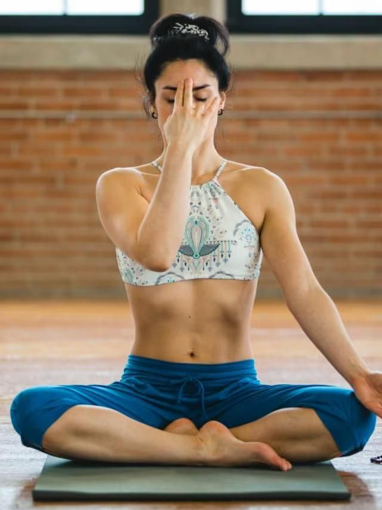

You breathe around twenty thousand times a day, and most of those breaths happen without a thought. Pranayama is the yogic practice of paying attention to the breath and, in some cases, shaping it deliberately. It is one of the three core components of yoga as practiced today, alongside postures and meditation or relaxation. Yet many people treat it as an afterthought, or they try complicated techniques before they have learned the basics.

This guide explains what pranayama means, how healthy breathing works, six beginner-friendly techniques, and how to build a short daily practice. It also includes safety information, because some breathing exercises are not suitable for everyone.

## What is pranayama?

Pranayama is a Sanskrit word often translated as "breath control" or "extension of the life force." "Prana" refers to vital energy or breath, and "ayama" means to extend or regulate. In the classical eight-limb framework of yoga, pranayama is the fourth limb, following the postures.

The U.S. National Center for Complementary and Integrative Health (NCCIH) notes that yoga as practiced in the United States typically emphasizes physical postures, breathing techniques (pranayama) and meditation. In modern practice, pranayama ranges from simple slow breathing to more advanced techniques involving breath retention and rapid breathing.

It is important to separate the traditional claims from what is supported by research. Traditional texts describe pranayama as affecting energy channels in the body. Modern science does not confirm those ideas, but it does study how slow, controlled breathing may affect the body's stress response. Evidence for specific yogic breathing techniques is mixed and often of low to moderate quality, so it is better to treat them as relaxation tools, not medical treatments.

## How breathing works

Understanding the basics makes the techniques much easier to practice.

- **The diaphragm** is a dome-shaped muscle under your lungs. When you inhale, it contracts and flattens, pulling air in and pushing your belly outward slightly. When you exhale, it relaxes
- **Chest breathing** relies on the muscles between the ribs and the neck and shoulder muscles. Many people breathe this way when stressed
- **Belly (diaphragmatic) breathing** uses the diaphragm and tends to be slower and calmer
- **Nasal breathing** filters, warms and humidifies air, and many yoga techniques use it unless noted

Most pranayama begins by learning to breathe smoothly through the nose, using the diaphragm, without forcing.

## Before you begin: setting up

- **Sit comfortably** on a chair, cushion or folded blanket, with your spine tall but not stiff. You can also lie on your back
- **Relax your face, jaw and shoulders**
- **Rest your hands** on your thighs or belly
- **Practice on an empty stomach,** or at least a couple of hours after a meal
- **Choose a quiet place** without drafts
- **Start with short sessions,** two to five minutes

## Six beginner-friendly techniques

### 1. Natural breath awareness

This is the simplest practice, and the foundation for all the rest.

1. Sit or lie comfortably and close your eyes
2. Without changing your breathing, notice the air entering and leaving your nostrils
3. Notice where you feel movement: belly, ribs or chest
4. When your mind wanders, gently return your attention to the breath
5. Continue for three to five minutes

### 2. Diaphragmatic (belly) breathing

1. Place one hand on your chest and one on your belly
2. Inhale slowly through the nose, letting your belly rise while your chest stays relatively still
3. Exhale slowly, feeling the belly fall
4. Continue for two to five minutes

If you feel dizzy, return to normal breathing. Practicing lying down makes this technique easier to learn.

### 3. Three-part breath (Dirga Pranayama)

1. Inhale into the belly, then the ribs, then the upper chest, in one smooth wave
2. Exhale from the upper chest, ribs, then belly
3. Keep the breath slow and effortless
4. Practice for three to five minutes

This technique fills the lungs gradually and is often taught at the start of a class.

[IMAGE: Illustration of the three parts of the breath: belly, ribs, chest]

### 4. Extended exhale breathing

1. Breathe in through the nose for a count of four
2. Breathe out slowly through the nose for a count of six
3. Repeat for two to five minutes
4. If six feels too long, try three in and five out. The exhale should always be a little longer than the inhale, without strain

Many people use this simple technique to unwind. It forms a good evening practice.

### 5. Alternate nostril breathing (Nadi Shodhana)

This is a classic calming technique.

1. Sit comfortably. Rest your left hand on your left knee
2. Use your right hand: fold your index and middle fingers toward your palm, so that your thumb and ring finger are free
3. Close your right nostril gently with your thumb and inhale slowly through the left nostril
4. Close your left nostril with your ring finger, release the thumb and exhale through the right nostril
5. Inhale through the right nostril
6. Close the right nostril, release the left, and exhale through the left
7. This is one round. Continue for five to ten rounds, with no breath holding

Keep the breath light and quiet. If your nose is blocked, skip this practice until it clears.

### 6. Humming bee breath (Bhramari)

1. Sit comfortably and close your eyes
2. Inhale slowly through the nose
3. As you exhale, make a soft, steady humming sound with your lips closed, feeling the vibration in your face and head
4. Repeat five to eight times

This is a gentle technique that many find soothing. Keep the hum soft and comfortable, and stop if you feel any discomfort in your ears.

## What research suggests

Research on pranayama is smaller and less consistent than research on yoga postures. The NCCIH reports that studies suggest yoga as a whole may help with stress management, mental and emotional health and sleep. A 2020 review of 12 studies with 672 participants found beneficial effects of different yoga types on perceived stress in healthy adults. However, these reviews usually examine combined yoga practice, including postures and breathing, so they do not isolate the effect of breathing exercises.

It is reasonable to say that slow, controlled breathing can help many people feel calmer in the moment, and it is a free, low-risk tool when practiced gently. It is not a replacement for medical or psychological treatment. NCCIH also notes that yoga may be helpful for anxiety symptoms in some populations, though there is little evidence of a benefit for people with anxiety disorders, so those people should seek professional help.

## A simple five-minute daily routine

1. **Settle (30 seconds):** sit comfortably and notice the natural breath
2. **Belly breathing (1 minute)**
3. **Extended exhale (2 minutes):** four in, six out
4. **Alternate nostril breathing (1 minute):** about five rounds
5. **Rest (30 seconds):** return to natural breathing and notice how you feel

Practice at the same time each day, such as after waking or before bed, to build a habit.

## Safety: this is where to be careful

Gentle breathing is safe for most people, but some pranayama techniques are not suitable for everyone, and a few should not be attempted without guidance.

- **Never force the breath.** Straining can cause dizziness, tension or discomfort
- **Avoid breath retention (kumbhaka)** as a beginner. Holding the breath can raise blood pressure and cause lightheadedness
- **Be cautious with fast or forceful techniques** such as Kapalabhati (skull-shining breath) and Bhastrika (bellows breath). They involve rapid breathing, which can cause dizziness, and they are not advised during pregnancy or for people with certain conditions. Learn them only from a qualified teacher
- **Stop if you feel dizzy, faint, tingling or anxious.** Return to normal breathing, lie down if needed and rest
- **Do not practice while driving** or in water
- **Do not use breathing practices to replace medical care** for any condition

Talk to a health care provider before practicing if you:

- Are pregnant
- Have asthma, COPD or other lung conditions
- Have heart disease or high blood pressure. MedlinePlus lists high blood pressure among conditions where some yoga practices may need to be avoided or modified
- Have a history of panic attacks, since focusing on breath can sometimes trigger anxiety in some people
- Have glaucoma or other eye conditions, particularly for techniques with strong abdominal pressure
- Have recently had surgery

## Common mistakes

- **Trying advanced techniques too soon,** particularly breath retention
- **Breathing too deeply and too fast,** which can cause lightheadedness
- **Tensing the shoulders and face**
- **Practicing when blocked or unwell,** such as with a cold
- **Expecting instant results.** The benefits, if they come, build gradually with regular practice
- **Treating it as a competition** in how long you can inhale, exhale or hold

## How to know the practice is working (and when to stop)

Because breathing exercises have no visible result, it helps to know what to look for. These signs usually mean the technique suits you:

- Your breath feels smooth, quiet and unforced
- Your shoulders, jaw and belly feel softer after a few minutes
- You feel more alert or calmer, without feeling dizzy
- You can return to normal breathing easily afterward

These signs mean you should stop and rest:

- Dizziness, lightheadedness or tingling in the hands and face
- A feeling of air hunger or panic
- Chest pain, a racing heart or shortness of breath that does not settle
- Headache or pressure in the head or ears

If any of the second list occur, return to natural breathing, sit or lie down, and drink some water. If symptoms continue, seek medical advice. Keep a short note of how each technique felt, such as "calming," "too fast" or "made me dizzy," so that you can build a practice that suits your body and avoid techniques that do not.

## Using pranayama in daily life

You do not need a mat or a special time to use these skills. Many people find a few slow breaths helpful in everyday moments:

- **Before a stressful conversation or meeting:** take five slow breaths with a longer exhale
- **While waiting in a queue or at traffic lights:** notice your natural breath for a minute
- **Before sleep:** try extended exhale breathing in bed, with your hand on your belly
- **After exercise:** return your breath to a smooth rhythm as your heart rate settles

These small moments add up. Treat them as gentle resets, not as a way to force calm. If you feel more tense when you focus on your breath, shift attention to something else, such as the feeling of your feet on the floor, and talk to a health professional if this keeps happening.

## Combining breath with movement

Breath is already part of most yoga classes. You can add awareness by:

- **Inhaling as you lengthen** and **exhaling as you fold or twist**
- **Matching the length of inhale and exhale** in slow movements
- **Pausing in poses** to notice your breath

If you are practicing flowing styles, see our guides to vinyasa and Sun Salutation for breath cues.

## Frequently asked questions

**How long should I practice pranayama?** Start with two to five minutes a day. A short daily practice is better than a long, occasional one.

**When is the best time?** Many people practice in the morning or evening. Choose a time when you will not be rushed or interrupted.

**Can pranayama cure anxiety or high blood pressure?** No. Slow breathing may help you feel calmer, but it is not a treatment. See a doctor for health conditions.

**Do I need a teacher?** For the gentle techniques in this article, you can start on your own. For more advanced techniques, learn from a qualified teacher.

**What if my mind keeps wandering?** That is normal. Each time you notice and return, you are doing the practice.

## Final thoughts

Pranayama offers a simple idea: your breath is always with you, and a little attention can make it a quiet, reliable support. Start gently, keep it comfortable, and choose consistency over intensity. Over time, many people find that the breath becomes a calm anchor in everyday life.

## Sources and further reading

- National Center for Complementary and Integrative Health (NCCIH), [Yoga: Effectiveness and Safety](https://www.nccih.nih.gov/health/yoga-effectiveness-and-safety)
- NCCIH, [Yoga: What You Need To Know](https://www.nccih.nih.gov/health/yoga-what-you-need-to-know)
- MedlinePlus, [Yoga](https://medlineplus.gov/ency/patientinstructions/000876.htm)

This article is general information, not medical advice. Consult a qualified professional about your health and your practice.
