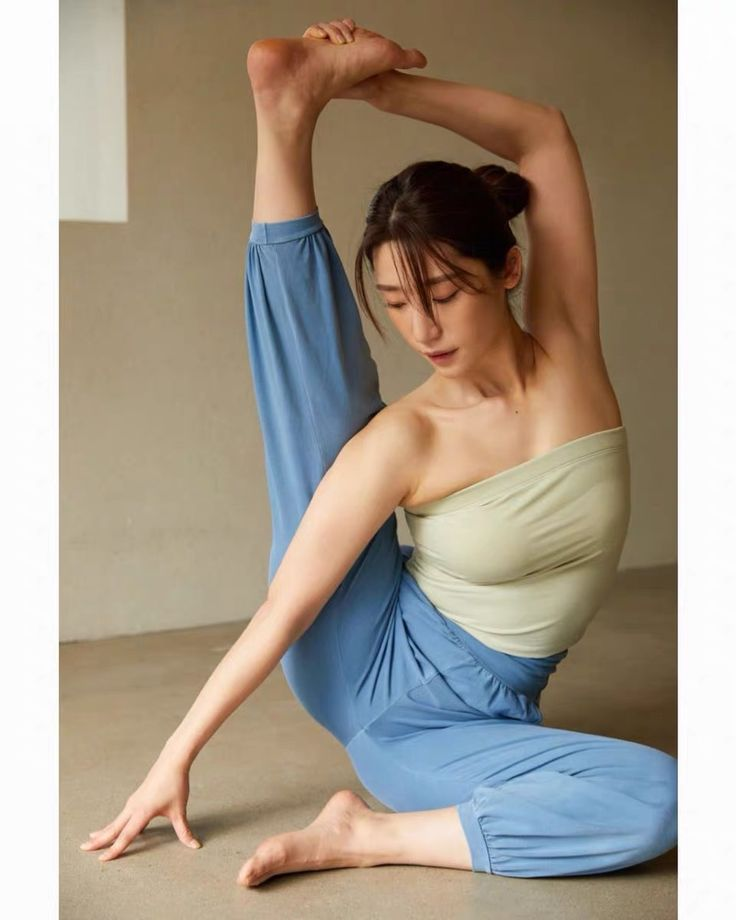

Some days you do not need a workout. You need rest that actually works. Restorative yoga is a style designed for exactly that: a small number of poses, supported by props such as bolsters, blankets and blocks, held for long periods so the body can fully relax. There is little stretching and almost no effort. The aim is to let your nervous system settle, so that you can recover from stress, fatigue or a demanding week.

This guide explains what restorative yoga is, how it differs from yin yoga, how to set up props properly, and how to practice six classic restorative poses. It also gives you a home sequence, safety notes and answers to common questions.

## What is restorative yoga?

Restorative yoga uses props to support the body completely in simple, comfortable positions, usually held for five to twenty minutes each. Because the props do the work, the muscles can release. A class may include only four to six poses, with long pauses and very little instruction.

The style grew from the teaching of B.K.S. Iyengar, whose method emphasizes alignment and the use of props, and was developed further by later teachers into the gentle practice taught today. It is often offered in the evening or as a recovery session, and it is widely accessible, including to people who are returning from illness or injury, with the guidance of a health professional.

## Restorative versus yin yoga

People often mix up the two, because both are slow and quiet. The difference lies in intent:

- **Restorative yoga** aims for deep relaxation. You are supported so that you do not feel stretch or effort
- **Yin yoga** aims to apply gentle, sustained stress to certain tissues through long holds, so a mild stretch sensation is expected
- **Props:** both use them, but restorative uses more of them, with the goal of eliminating effort
- **Poses:** restorative poses are mostly reclining or supported, while yin includes seated and floor poses that create stretch

If a pose feels like a stretch in restorative practice, adjust your props until it feels like rest.

## What research suggests

Studies on yoga in general, not restorative yoga specifically, point to possible benefits. The U.S. National Center for Complementary and Integrative Health (NCCIH) states that studies suggest yoga may help manage stress and support sleep, mental and emotional health, and balance. A 2020 review of 12 studies with 672 healthy adults found beneficial effects of yoga on perceived stress in all the studies. The NCCIH also cautions that yoga research varies widely, because styles and study designs differ, so conclusions are limited.

It would be inaccurate to say restorative yoga treats any medical condition. A fair summary is that slow, supported practice offers a structured way to rest, breathe and unwind, and that many people find it helpful for stress and sleep.

## Props: what you need and how to use them

You can start with household items:

- **A bolster:** use a firm pillow, a rolled blanket or a stack of folded blankets
- **Two or three blankets:** for padding, warmth and support under knees, head or neck
- **Two blocks:** or sturdy books
- **A strap:** or a belt or scarf
- **An eye pillow or a folded cloth:** optional, to rest over your eyes
- **A wall:** for supported leg elevation

**Setting up well matters more than any single pose.** Use these guidelines:

1. **Support every part that wants to hang.** If your head, knees or arms feel unsupported, add a blanket
2. **Stay warm.** Body temperature drops when you are still, so cover yourself with a blanket and wear socks
3. **Check your breathing.** If you cannot breathe easily, the pose needs adjusting
4. **Aim for zero strain.** If you feel tension, use more padding or choose a different position

## Creating the right environment

- **Dim the lights** and silence your phone
- **Choose a quiet time,** such as evening or a break in your day
- **Keep a timer** with a soft alarm so you don't have to watch the clock
- **Practice on a mat** or carpet to avoid slipping

## Six supported poses

### 1. Supported Child's pose

Kneel with your knees wide and place a bolster lengthwise between them. Sit back on your heels, then fold forward so your torso rests on the bolster, with your head turned to one side. Add blankets between thighs and calves if sitting on your heels is uncomfortable. Turn your head to the other side halfway through. Stay for five to ten minutes.

### 2. Supported reclining bound angle (Supta Baddha Konasana)

Place a bolster along your spine, short end against your sitting bones. Sit in front of it, bring the soles of your feet together and let your knees open, supporting each knee with a block or rolled blanket so the inner thighs do not strain. Recline back so that your spine, ribs and head rest on the bolster. Add a folded blanket under your head if your chin tilts upward. Rest your arms out to the sides with palms up. Stay for five to fifteen minutes.

[IMAGE: Supported reclining bound angle pose with blocks under the knees]

### 3. Legs up the wall (Viparita Karani)

Sit sideways next to a wall, and swing your legs up the wall as you lie back. Your hips can be right against the wall or a few inches away. A folded blanket under your lower back and hips is optional. Rest your arms out to the sides and close your eyes. Stay for five to fifteen minutes. If your legs feel numb or tingling, bend your knees and rest your feet on the wall, or lower your legs and rest.

### 4. Supported supine twist

Lie on your back with a bolster or stacked blankets on one side. Bend your knees and gently lower both legs over the bolster so that they rest on it, twisting only a little. Turn your head slightly away from your knees. Stay for three to five minutes, then repeat on the other side. The twist should feel mild and soothing, never strong.

### 5. Supported bridge

Lie on your back with your knees bent. Lift your hips and slide a block (at its lowest or middle height) or a firm bolster under your sacrum, the flat bone at the base of the spine, so that it is fully supported. Let your legs rest long or bent, whichever is more comfortable. Rest your arms by your sides. Stay for three to five minutes. If you feel pressure in your lower back, lower the height or move the prop slightly.

### 6. Savasana (final relaxation)

Lie on your back with your legs slightly apart. Place a bolster or rolled blanket under your knees to ease the lower back, and a small folded blanket under your head. Cover yourself with a blanket and, if you like, place an eye pillow over your eyes. Let your breath become natural. Stay for ten to twenty minutes. If you are prone to falling asleep, that's fine at home, though you may prefer to set a gentle alarm.

## A 45-minute restorative sequence

1. **Settle (3 minutes):** lie down, breathe slowly, scan for tension
2. **Supported Child's pose (7 minutes)**
3. **Supported supine twist (4 minutes per side)**
4. **Supported bridge (4 minutes)**
5. **Supported reclining bound angle (8 minutes)**
6. **Legs up the wall (6 minutes)**
7. **Savasana (8 minutes)**

If you only have fifteen minutes, choose legs up the wall and Savasana.

## Breathing in restorative practice

You do not have to do anything special. Let your breath be natural and soft. If you want a simple aid, try this:

- Breathe in through your nose for a count of four
- Breathe out for a count of six, as if gently fogging a window
- Repeat for a few minutes

If any breathing exercise makes you feel lightheaded or anxious, return to normal breathing. Slow breathing practices can be helpful but should never feel forced.

## Common mistakes

- **Not enough support.** If you feel strain, add padding
- **Staying cold.** A chilly body struggles to relax
- **Checking the time constantly.** Use a gentle timer
- **Treating it as a stretching routine.** The aim is rest, not flexibility
- **Falling into scrolling.** Put the phone away so your nervous system can settle
- **Rushing out.** Come out slowly, roll to one side and pause before sitting up, since you may feel light-headed

## Who benefits most

Restorative yoga can suit:

- People who feel run down or overstimulated
- Anyone who exercises hard and wants a recovery day
- Beginners who find active classes overwhelming
- People who find it hard to switch off in the evening
- Those who want a gentle practice during busy or stressful periods

## Safety and who should take extra care

Restorative yoga is gentle, but it is still yoga, and the NCCIH reminds us that injuries can occur and that practice with a qualified instructor lowers risk. Speak to a health care provider before starting if you:

- **Are pregnant.** Many restorative poses can be adapted, but lying flat on your back for long periods is usually avoided, and positions should be approved by your provider
- **Have high blood pressure, glaucoma, sciatica or arthritis.** MedlinePlus lists these among conditions where some poses may need to be avoided or modified. Poses with the legs elevated or head lowered may not suit people with certain eye or blood pressure conditions
- **Have a recent injury or surgery,** or unexplained pain
- **Experience anxiety or distress during stillness.** For some people, quiet and eyes-closed practices can bring up difficult feelings. If this happens, keep your eyes open, shorten the holds or talk to a qualified professional

Restorative yoga should not replace medical care for any condition.

## How often should you practice?

Once or twice a week is a good start, and you can practice more often if you find it helpful. Because it is very gentle, it can be done on days when you are tired, sore or short on motivation. Even 10 minutes of legs up the wall and a few quiet breaths is worthwhile.

## Frequently asked questions

**Is restorative yoga a real workout?** No. It is not designed to build strength or fitness. It is a recovery practice.

**Will I fall asleep?** Possibly, and that is fine if you are at home. If you want to stay awake, practice earlier in the day and keep your eyes slightly open.

**Do I need special equipment?** No. Pillows, blankets and a belt can replace most props.

**How is it different from simply lying down?** The poses are arranged to support alignment and breathing, and the intention is to practice deliberate relaxation, which is different from lounging, though both can be valuable.

**Can restorative yoga help with sleep?** Studies suggest yoga may support sleep, according to the NCCIH, though evidence varies by style and study. Practicing in the evening may help you wind down, but it is not a treatment for sleep disorders. If you have persistent sleep problems, speak to a doctor.

## Final thoughts

Restorative yoga asks you to do something unusual in modern life: nothing, on purpose. With a few props, a quiet space and a willingness to slow down, you can give your body and mind a regular chance to recover. Start with one pose, take your time and let rest be enough.

## Sources and further reading

- National Center for Complementary and Integrative Health (NCCIH), [Yoga: Effectiveness and Safety](https://www.nccih.nih.gov/health/yoga-effectiveness-and-safety)
- NCCIH, [5 Things You Should Know About Yoga](https://www.nccih.nih.gov/health/tips/yoga?nav=cd)
- MedlinePlus, [Yoga](https://medlineplus.gov/ency/patientinstructions/000876.htm)

This article is general information, not medical advice. Consult a qualified professional about your health and your practice.
