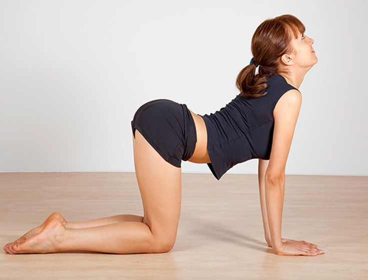

If yoga had a signature move, it would be Sun Salutation. Known in Sanskrit as Surya Namaskar, it is a short sequence of poses linked by breath that appears at the start of countless classes, in many styles. It is a warm-up, a workout and a moving meditation all at once. It is also one of the most useful things a beginner can learn, because it teaches several key movements, such as forward folds, planks and backbends, in a single, repeatable flow.

This guide explains where Sun Salutation comes from, how to practice a gentle beginner version, how to progress to the commonly taught Sun Salutation A and B, and how to adapt the sequence for wrists, back and tight hamstrings. It also covers breath, common mistakes and safety.

## What is Sun Salutation?

Surya means "sun" and namaskar means "salutation" or "bow." The sequence is traditionally performed facing the rising sun, though you can practice it any time. In its many forms, it links a series of poses, usually between ten and twelve, into a flowing cycle, so that you begin and end in the same standing position.

Different traditions teach different versions. The two most common in modern classes are:

- **Sun Salutation A (Surya Namaskar A):** a shorter, simpler sequence used in Ashtanga and vinyasa classes
- **Sun Salutation B (Surya Namaskar B):** a longer sequence that adds chair pose and Warrior I

Many hatha classes teach a twelve-pose version. All versions share the same idea: move with your breath, warm up the whole body and finish where you started.

## Why practice it?

Sun Salutation works the whole body in a relatively small amount of time:

- **Mobility:** it moves the spine in flexion (forward fold) and extension (backbend), and opens hips, hamstrings, shoulders and chest
- **Strength:** plank, chaturanga and the standing poses build strength in the arms, core and legs
- **Breath awareness:** linking each movement with an inhale or exhale trains attention
- **Efficiency:** five to ten rounds take only ten to fifteen minutes

The U.S. National Center for Complementary and Integrative Health (NCCIH) says that studies suggest yoga may help with stress management, mental and emotional health, sleep and balance. Studies of specific sequences like Sun Salutation are limited, so it is more accurate to describe it as a convenient, moderate form of exercise within yoga practice than as a proven treatment for anything.

## The basic rules of the flow

1. **Move with the breath.** Inhale when you lengthen or lift, exhale when you fold or lower
2. **Keep the breath smooth,** through the nose if you can
3. **Go slowly at first.** Learn each position before you link them
4. **Modify freely.** Knees down, bent legs and smaller movements are all valid
5. **Stop if anything hurts.** Mild effort is normal, but sharp pain is not

## A gentle beginner version (nine steps)

This version simplifies the sequence for beginners. Take two to three breaths in each position at first, then gradually move to one breath per movement.

1. **Mountain pose.** Stand with your feet hip-width apart, arms by your sides. Breathe naturally
2. **Upward salute.** Inhale, sweep your arms overhead, and look up slightly if it is comfortable
3. **Forward fold.** Exhale, hinge from the hips and fold forward with soft knees. Let your head hang
4. **Halfway lift.** Inhale, lift your chest and place your hands on your shins with a long spine
5. **Step back to plank.** Exhale, place your hands on the mat and step each foot back, or kneel down for a modified plank
6. **Lower down.** Exhale, lower your knees, chest and chin to the floor, or lower your whole body to the mat
7. **Cobra.** Inhale, press gently into your hands and lift your chest, keeping your elbows bent and your thighs and hips on the mat
8. **Downward-facing dog.** Exhale, tuck your toes, lift your hips up and back, and stay for three to five breaths
9. **Step forward and rise.** Look between your hands, step your feet forward, fold, then inhale to rise to standing with arms overhead and exhale, bringing the hands to your chest

Repeat three to five times. Over a few weeks, you can reduce the pauses and let the movements flow.

[IMAGE: Step-by-step illustration of the nine-step gentle beginner sequence]

## Sun Salutation A, step by step

Sun Salutation A is a staple of vinyasa and Ashtanga classes. Here is a clear version:

1. **Mountain pose (Tadasana).** Stand with your feet together or hip-width apart, arms at your sides
2. **Upward salute (Urdhva Hastasana).** Inhale, sweep your arms up and look toward your thumbs
3. **Standing forward fold (Uttanasana).** Exhale, fold forward, bending your knees as much as needed
4. **Halfway lift (Ardha Uttanasana).** Inhale, lift your chest and lengthen your spine, hands on shins or fingertips on the floor
5. **Plank to low plank (Chaturanga).** Exhale, step or jump back to plank, then lower halfway down with elbows close to the ribs. Beginners should lower their knees
6. **Upward-facing dog or Cobra.** Inhale, roll forward and lift your chest. Use Cobra if you have back, wrist or shoulder concerns
7. **Downward-facing dog.** Exhale, lift your hips up and back. Stay for five breaths
8. **Halfway lift.** Inhale, look forward, step or hop your feet between your hands and lift halfway
9. **Forward fold.** Exhale, fold over your legs
10. **Upward salute.** Inhale, rise with a long spine and arms overhead
11. **Mountain pose.** Exhale, lower your hands to your chest or sides

Repeat three to five rounds. Beginners can start with two to three rounds and build up.

## Sun Salutation B, step by step

Sun Salutation B is longer, adding chair pose and Warrior I.

1. **Mountain pose.** Stand tall
2. **Chair pose (Utkatasana).** Inhale, bend your knees as though sitting in a chair, and raise your arms overhead
3. **Forward fold.** Exhale, straighten your legs and fold forward
4. **Halfway lift.** Inhale, lengthen your spine
5. **Plank to low plank.** Exhale, step back and lower, with knees down if needed
6. **Upward-facing dog or Cobra.** Inhale
7. **Downward-facing dog.** Exhale
8. **Warrior I (right side).** Inhale, step your right foot forward between your hands, pivot your left heel down, rise and raise your arms overhead. Bend your right knee over the ankle
9. **Plank to low plank.** Exhale, place your hands down, step back to plank and lower
10. **Upward-facing dog or Cobra.** Inhale
11. **Downward-facing dog.** Exhale
12. **Warrior I (left side).** Inhale, step your left foot forward and rise
13. **Plank to low plank, up dog, down dog.** Repeat the transition
14. **Halfway lift, forward fold, chair, mountain.** Step forward, lift halfway, fold, rise into chair pose and return to Mountain

Do two to three rounds to start. This sequence is demanding, so build up gradually.

## Breath guide

A quick reference:

- **Inhale:** upward salute, halfway lift, upward dog or Cobra, rise to standing
- **Exhale:** forward fold, plank and lowering, downward dog, return to Mountain pose

If your breath becomes strained, slow down, take extra breaths in a position, or rest in Child's pose.

## Modifications

- **Sensitive wrists:** practice on forearms for plank, use blocks under your hands or make light fists
- **Shoulder discomfort:** keep your knees down, avoid dropping low in chaturanga, and lower fully to the floor instead
- **Lower back sensitivity:** bend your knees in forward folds, use Cobra instead of Upward Dog, and keep your core gently engaged
- **Tight hamstrings:** keep your knees bent in folds and in Down Dog. Place your hands on blocks or a chair
- **Balance concerns:** stand near a wall or hold a chair for support in the standing sections
- **Limited mobility:** practice a seated or chair-based version of the arm movements, or ask a teacher for suggestions

## Common mistakes

- **Rushing.** Speed makes mistakes more likely. Slow movement builds strength and accuracy
- **Sinking in chaturanga,** letting the shoulders dip below the elbows or the hips sag
- **Overarching the lower back** in upward dog or cobra
- **Locking the knees** in standing forward folds
- **Holding the breath** during the transitions
- **Skipping the warm-up** for stiff wrists and hamstrings
- **Jumping before you are ready.** Stepping is safe and effective

## Safety and who should take extra care

The NCCIH notes that yoga is generally considered safe for healthy people when practiced appropriately, but injuries can occur, and learning without supervision has been associated with increased risks. If possible, learn Sun Salutation in a class or with a qualified teacher.

Talk to a health care provider before practicing if you:

- Are pregnant. Some positions, such as lying on the belly, deep folds and intense core work, need modification
- Have high blood pressure, glaucoma, sciatica or arthritis. MedlinePlus lists these among conditions in which some poses should be avoided or modified, and head-down positions like forward folds and down dog may not suit every condition
- Have wrist, shoulder, back or neck injuries
- Have recently had surgery
- Experience dizziness when moving from standing to folding and back. Come up slowly

Stop if you feel pain, dizziness or unusual shortness of breath.

## How many rounds should you do?

- **Beginners:** two to three rounds of the gentle version
- **Intermediate:** five rounds of A, or three of A and three of B
- **Experienced:** up to ten rounds, as part of a longer practice

Quality matters more than quantity. A few well-done rounds are better than many careless ones. Some traditions count 12 or 108 rounds for ceremonial purposes, but this is not necessary for general health practice.

## A 10-minute morning routine

1. **Cat-Cow (1 minute)** to warm the spine
2. **Down Dog (1 minute)**, pedaling your feet
3. **Sun Salutation, gentle version (5 minutes),** about four rounds
4. **Standing forward fold (1 minute)**
5. **Mountain pose (1 minute),** breathing slowly, hands at your chest

This simple routine helps you start the day with movement and attention.

## Tracking your progress

Because Sun Salutation is repeated, it is a useful way to notice change over time. Instead of measuring how deep you can fold, try tracking things that matter more for long-term practice. For example, how many rounds you can do with smooth breathing, whether your wrists feel comfortable in plank, how much you need to bend your knees in the forward fold, and how steady you feel in downward dog. Write one line after each session, such as "five rounds, wrists fine, breath smooth." After a month, look back and you will probably see patterns you could not feel day to day.

## Frequently asked questions

**When is the best time to practice?** Morning is traditional, but any time works. Practice on an empty stomach or a couple of hours after eating.

**Is Sun Salutation enough as a workout?** It provides moderate exercise, particularly when practiced for ten to fifteen minutes. Many people combine it with walking, strength training or other activities.

**Is it good for weight loss?** The NCCIH reports that a review of yoga-based weight-control programs found gradual, moderate weight reductions, particularly in programs with longer and more frequent sessions. A short Sun Salutation routine is a good start, but weight depends on many factors, including diet.

**Do I need to jump back to plank?** No. Stepping back is safer and fully acceptable.

**Can I practice every day?** Many people do. If you feel sore or tired, shorten the session or switch to a gentler practice.

## Final thoughts

Sun Salutation rewards simple, regular practice. Begin with the gentle version, keep your breath steady and take your time. In a few weeks, the sequence will feel familiar and flowing, and you will have a reliable way to warm up your body and start your day.

## Sources and further reading

- National Center for Complementary and Integrative Health (NCCIH), [Yoga: Effectiveness and Safety](https://www.nccih.nih.gov/health/yoga-effectiveness-and-safety)
- NCCIH, [5 Things You Should Know About Yoga](https://www.nccih.nih.gov/health/tips/yoga?nav=cd)
- MedlinePlus, [Yoga](https://medlineplus.gov/ency/patientinstructions/000876.htm)

This article is general information, not medical advice. Consult a qualified professional about your health and your practice.
