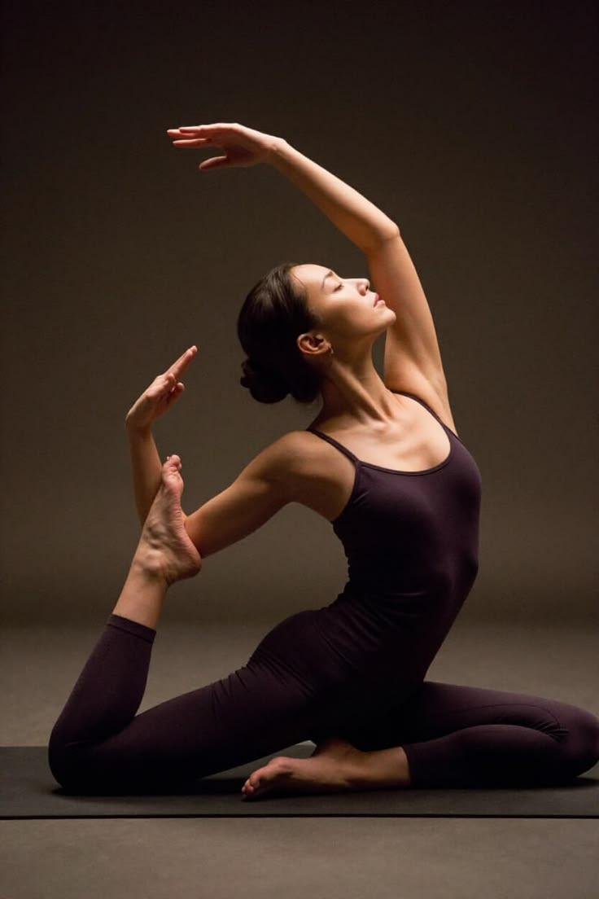

Vinyasa is the style most people picture when they imagine a modern yoga class: a sequence of poses linked together by breath, with the body moving continuously from one shape to the next. It is energetic, creative and usually more physically demanding than hatha. It can also be confusing for beginners, because no two vinyasa classes are alike, and the pace can feel fast if you are not familiar with the basic movements.

This guide explains what vinyasa really means, how it differs from other styles, how to perform the core movements safely, and how to practice a simple flow at home. It also covers common mistakes, modifications and who should take extra care.

## What vinyasa means

The Sanskrit word vinyasa is often translated as "to place in a special way," and in practice it refers to two related ideas:

1. **Linking movement with breath.** Each movement begins with an inhale or an exhale, so the breath sets the pace
2. **A flowing sequence of poses.** Instead of holding a pose for a long time, you move through a series of postures, often returning to a repeated transition called "a vinyasa"

In many classes, "a vinyasa" refers to the transition of plank, low push-up (chaturanga), upward-facing dog and downward-facing dog that connects one side or sequence to the next. Teachers often say "take a vinyasa" to mean this specific sequence.

Vinyasa grew out of the Ashtanga system, but unlike Ashtanga, which follows fixed series, vinyasa classes are usually creative, and the sequence changes from teacher to teacher. That variety keeps classes interesting, but it also means you need to know your own limits.

## How vinyasa differs from hatha and other styles

- **Pace.** Vinyasa is faster than hatha, and poses are usually held for one to five breaths
- **Structure.** Hatha tends to be slower and more static, Ashtanga uses fixed sequences, and vinyasa is free-form
- **Intensity.** The continuous movement raises the heart rate and builds heat, so many people find it a stronger workout
- **Music and atmosphere.** Many vinyasa classes use music and a more dynamic atmosphere, though this depends on the teacher

MedlinePlus describes the range of yoga styles as running from mild to intense, with options such as hatha at the gentler end and more demanding styles at the other end. Vinyasa generally sits in the moderate to vigorous range.

## Benefits and what research suggests

Because vinyasa is a physically active style, it offers the benefits of moderate exercise: improved mobility, muscular endurance and a sense of well-being. The NCCIH says studies suggest yoga may help with stress management, mental and emotional health, sleep and balance, but it adds that results vary by style and study quality, which makes the research hard to compare. It is more accurate to say yoga "has shown promise" than to claim that it works for everything.

For people hoping to use vinyasa for fitness or weight control, the NCCIH reports that a review of 17 yoga-based weight-control programs found most produced gradual, moderate reductions in weight, with better results in programs that had longer and more frequent sessions. That does not mean any single class will change your weight, but regular practice combined with healthy habits may help.

## The breath in vinyasa

Most vinyasa teachers cue a simple pattern:

- **Inhale** when you lengthen, lift or open (for example, raising your arms or lifting your chest)
- **Exhale** when you fold, twist or lower (for example, folding forward or lowering into chaturanga)

Many classes use ujjayi breath, a gentle, audible breath made by slightly narrowing the throat so that the breath makes a soft ocean-like sound. If you are new, you can simply breathe through your nose smoothly and evenly. Do not force or strain the breath. If your breath becomes ragged, slow down or rest.

## The core vinyasa movements, step by step

The following sequence is the transition you will meet most often. Learn it slowly before you try to move quickly.

### Plank pose

From hands and knees, step your feet back so your body forms a straight line from head to heels. Place your hands under your shoulders, spread your fingers, and draw your belly in. Keep your neck long and your gaze slightly forward. If this is too much, keep your knees on the mat.

### Chaturanga Dandasana (low plank)

From plank, shift your weight forward slightly and bend your elbows straight back, keeping them close to your ribs, lowering until your upper arms are about parallel to the floor. Keep your shoulders from dropping below your elbows. Many beginners and even experienced students sink too low and strain their shoulders. The safer options are to lower your knees to the floor first, or to lower your whole body down onto the mat with control.

[IMAGE: Chaturanga with elbows hugging the ribs, and the knees-down modification]

### Upward-Facing Dog (Urdhva Mukha Svanasana)

From lying on your belly or from chaturanga, press into your hands, straighten your arms and lift your chest and thighs off the floor, with only the tops of your feet and your hands on the mat. Keep your shoulders away from your ears and avoid crunching your lower back. If this is tough on your back or wrists, substitute Cobra: keep your thighs and hips on the floor, bend your elbows slightly and lift only your chest.

### Downward-Facing Dog (Adho Mukha Svanasana)

Tuck your toes, lift your hips up and back, and press the floor away. Keep your knees bent as much as you need to lengthen your spine. Hold for a few breaths or move on.

## A beginner-friendly vinyasa flow

Practice this on a mat with room to move. Beginners should keep knees down in chaturanga and use Cobra instead of Upward Dog.

**Warm-up (5 minutes)**

1. Easy seated breathing, one minute
2. Cat-Cow on hands and knees, eight rounds
3. Child's pose, five breaths
4. Gentle Downward Dog, five breaths, pedaling the feet

**Sun-style flow (10 minutes)**

1. Stand in Mountain pose, inhale and raise your arms
2. Exhale and fold forward
3. Inhale, lift your chest halfway, exhale, fold again
4. Exhale, step back to plank (or lower your knees)
5. Exhale, lower down (chaturanga on knees or full body)
6. Inhale, Cobra or Upward Dog
7. Exhale, Downward Dog
8. Hold Down Dog for three breaths, then step forward
9. Inhale, halfway lift; exhale, fold; inhale, rise and reach up

Repeat three to five times, going slowly. For more on this series, see our Sun Salutation guide.

**Standing sequence (8 minutes)**

1. From Down Dog, step the right foot forward into a low lunge
2. Inhale, rise into Warrior I
3. Exhale, open to Warrior II
4. Inhale, reverse the arm and lean back gently, or keep your arms in place
5. Exhale, return to Warrior II, then step back to plank
6. Take a vinyasa (plank, lower, Cobra, Down Dog)
7. Repeat on the left side

**Cool-down (7 minutes)**

1. Low lunge with a gentle hip stretch, both sides
2. Seated forward fold, five breaths
3. Supine twist, one to two minutes each side
4. Savasana, three to five minutes

Total: about 30 minutes.

## Tips for moving safely

- **Slow down.** Speed is not a goal. Control is
- **Protect your shoulders.** Keep your elbows hugging your ribs in chaturanga, and don't drop your chest below elbow height
- **Protect your wrists.** Spread your fingers wide, press through the whole hand and use a folded mat or the edge of a mat if needed
- **Protect your lower back.** Keep your core gently engaged in plank and use Cobra if Upward Dog hurts
- **Modify freely.** Knees down, hands on blocks, or taking Child's pose instead of a vinyasa are all valid
- **Rest when you need to.** In class, nobody expects you to keep up with every transition

The NCCIH notes that yoga is generally considered safe for healthy people when practiced appropriately, but that learning without supervision has been associated with increased risk. For this reason, attending a beginner vinyasa class where a teacher can check your alignment is worth considering.

## Common mistakes

- **Rushing through chaturanga** and letting the shoulders collapse
- **Overarching the lower back** in Upward Dog
- **Holding the breath** during the more demanding transitions
- **Skipping the warm-up,** especially for wrists and hamstrings
- **Comparing your flow to others.** Each person's pace and range is different
- **Skipping Savasana** to save time

## Who should take extra care

Vinyasa is dynamic and may not be right for everyone without modification. Speak to a doctor or physiotherapist first if you:

- Are pregnant, because positions such as lying on the belly, deep twists and intense core work need modification
- Have high blood pressure, glaucoma, or sciatica, which MedlinePlus lists among conditions where some poses need to be avoided or modified
- Have wrist, shoulder, elbow or back injuries
- Have recently had surgery
- Experience dizziness, chest pain or shortness of breath during practice, in which case you should stop and seek medical advice

Tell your teacher about any condition or injury before class, so they can offer alternatives.

## Modifications for wrists, shoulders and low energy days

Not every day is a high-energy day, and vinyasa works best when you adapt it. A few practical swaps keep the flow going without strain:

- **Sensitive wrists:** place your hands on yoga blocks or a firm cushion, or come onto your forearms for plank. You can also make light fists, or use a wedge under the heels of your hands to reduce the angle.
- **Tired or injured shoulders:** skip chaturanga and lower your whole body to the floor, then lift into Cobra with your elbows bent. Reduce the number of repetitions and rest in Child's pose between rounds.
- **Tight hamstrings:** bend your knees generously in Down Dog and forward folds so your spine stays long. Pedal your feet or hold your knees bent for the whole pose.
- **Low energy:** choose a "slow flow" and hold poses for five breaths. Take Child's pose whenever you like. A gentle practice done regularly is worth more than a hard one you dread.
- **Limited space:** many vinyasa transitions can be adapted to a smaller area by stepping, not jumping, between poses. Stepping back from a fold is safer than jumping, and many teachers recommend it for beginners.

Remember that a vinyasa class is a guide, not an instruction to keep up. You are free to pause, modify or skip any movement.

## Choosing a class or video

A good vinyasa teacher explains transitions, offers modifications and respects your limits. Look for descriptions such as "slow flow," "beginner vinyasa" or "foundations," which usually mean a slower pace and clear instruction. MedlinePlus advises choosing an instructor you enjoy working with who does not push you in ways you are not comfortable. For online classes, choose teachers with clear training, and pause or rewind whenever you need.

## How often to practice

Two to three sessions per week of 30 to 45 minutes is a sensible starting point, with rest days in between if you feel sore. As your strength and familiarity improve, you can lengthen the sessions or add a fourth day. Pair vinyasa with gentler practices such as yin or restorative yoga to balance the intensity.

## Frequently asked questions

**Is vinyasa good for beginners?** Yes, if you choose a beginner-level class or modify the movements. The pace can be challenging, so start slowly.

**What is the difference between vinyasa and power yoga?** Power yoga is usually a faster, more athletic form of vinyasa with more emphasis on strength. The terms overlap, so check the class description.

**Will vinyasa help me lose weight?** It can contribute to a healthy active lifestyle, but weight changes depend on many factors, including diet. Research suggests that yoga-based programs may lead to gradual, moderate weight reductions when practiced frequently over time.

**Can I do vinyasa every day?** Many people do, as long as they vary intensity and listen to their bodies. If you feel pain, fatigue or irritated joints, take a gentler day.

## Final thoughts

Vinyasa rewards patience. Learn the core movements one at a time, let your breath set the pace and keep your modifications close. Over time, the flow becomes less of a performance and more of a moving meditation, one breath at a time.

## Sources and further reading

- National Center for Complementary and Integrative Health (NCCIH), [Yoga: Effectiveness and Safety](https://www.nccih.nih.gov/health/yoga-effectiveness-and-safety)
- NCCIH, [5 Things You Should Know About Yoga](https://www.nccih.nih.gov/health/tips/yoga?nav=cd)
- MedlinePlus, [Yoga](https://medlineplus.gov/ency/patientinstructions/000876.htm)

This article is general information, not medical advice. Consult a qualified professional about your health and your practice.
