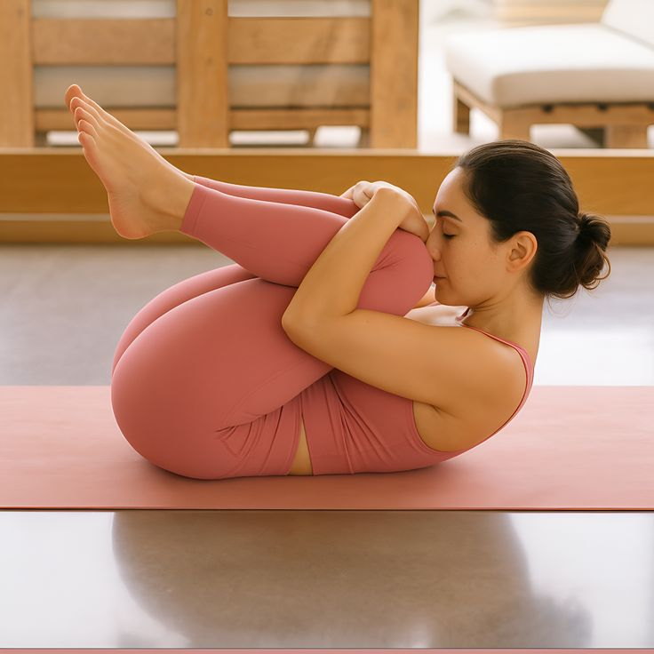

Most yoga styles ask you to move, build heat and work your muscles. Yin yoga does something different. Poses are held for several minutes in quiet, supported stillness, with the muscles kept as relaxed as possible. For many people, the result is a practice that feels like a deep, slow stretch and a break from the speed of daily life. For others, it is surprisingly hard, because holding still can be more challenging than moving.

This guide explains what yin yoga is, what it does and does not do, how to practice it safely, and how to perform eight classic poses. It also includes a 30-minute home sequence, advice on props and notes on who should be careful.

## What is yin yoga?

Yin yoga is a slow-paced style in which you hold mostly seated or lying poses for around three to five minutes, sometimes longer for experienced practitioners. The name comes from the yin and yang idea in Chinese philosophy, in which yang refers to active, dynamic qualities and yin to still, receptive ones. In this framework, most mainstream yoga styles are considered "yang," because they involve muscular effort and movement, while yin is the quiet counterpart.

Yin yoga as taught today was shaped by yoga teachers in the late twentieth century, who combined yoga postures with ideas from Taoist practice. Today it is widely offered in studios and online as a complement to more active styles, and it often appeals to runners, lifters and anyone who sits for long periods.

## How yin differs from other styles

- **Long holds.** Poses are held for minutes, not breaths
- **Muscles relax.** Instead of engaging muscles, you aim to let gravity do the work and keep the muscles passive
- **Targets deeper tissue.** Teachers often say yin focuses on connective tissue such as fascia and the tissues around the joints, mainly in the hips, pelvis and lower spine. Scientific evidence on how and whether yin changes connective tissue is limited, so it is best to treat this as a teaching model, not a proven fact
- **Few poses.** A class may include only five to eight poses
- **Quiet atmosphere.** Many classes include minimal talking and soft music or silence

## What yin yoga might do for you

The research on yoga as a whole is broader than the research on yin specifically. The U.S. National Center for Complementary and Integrative Health (NCCIH) reports that studies suggest yoga may help with stress management, mental and emotional health, sleep and balance. A 2020 review of 12 studies with 672 participants found beneficial effects of different yoga types on perceived stress in healthy adults. These reviews cover many styles, so we can't directly credit yin yoga, but a calming, slow style is consistent with those goals.

People commonly report that yin practice helps them:

- **Feel more relaxed** after a busy day
- **Notice tension** in the hips and back
- **Practice patience** and tolerate discomfort without reacting
- **Balance more active exercise** with gentle recovery

These are experiences, not guaranteed outcomes. It is reasonable to approach yin as a way to slow down, with any flexibility gains as a bonus.

## How long should you hold a pose?

Beginners can start with one to two minutes per pose, then build up gradually to three to five minutes. In class, a teacher will usually time the holds. At home, you can use a quiet timer.

How does the pose feel? The goal is a mild to moderate sensation of stretch, sometimes described as a dull, spread-out ache that you can breathe through. It should not be:

- Sharp, stabbing or burning pain
- Pinching in a joint, especially the knees
- Numbness or tingling
- A sensation that makes you hold your breath

If any of these happen, come out of the pose slowly, and use props or a smaller version next time.

## Props you will want

Yin yoga relies on support, and props are not cheating. They help you relax into the pose. Useful items include:

- **A bolster or firm pillow** for supported poses
- **Two blocks** for under the knees or hips
- **A blanket** for padding, warmth and support under knees
- **A strap** to reach feet without straining
- **A wall** for supported inversions or leg elevation

## Eight classic yin poses

For each pose, settle in slowly, adjust props until your muscles can soften, and breathe naturally. Come out of the pose slowly, and rest between poses.

### 1. Butterfly (Baddha Konasana, folded)

Sit with the soles of your feet together and knees falling open. Sit on a folded blanket if your hips are tight. Fold forward, resting your hands, forearms or head on a bolster or blocks. Keep your spine long at first, then let it round gently. Hold for three to five minutes. This stretches the inner thighs and back.

### 2. Caterpillar (seated forward fold)

Sit with your legs extended and a slight bend in the knees, supported by a bolster under them if needed. Let your back round gently as you fold forward, resting your hands on your legs or the floor. Keep your shoulders and neck relaxed. This pose stretches the hamstrings and spine.

### 3. Sphinx or Seal (gentle backbend)

Lie on your belly and prop yourself up on your forearms, elbows under shoulders (Sphinx). For a deeper version, straighten your arms a little (Seal). Keep your legs relaxed and your lower back comfortable. If you feel pinching in the lower back, lower your chest or place a blanket under your ribs. Hold for one to three minutes.

### 4. Child's pose

Kneel and sit back toward your heels, with knees wide or together. Rest your forehead on the mat or a block, and extend your arms forward or alongside your body. A bolster between your knees and under your torso makes this more restful. Hold for two to five minutes.

[IMAGE: Child's pose supported by a bolster]

### 5. Dragon (low lunge)

From hands and knees, step your right foot forward between your hands into a low lunge, left knee on the mat with padding under it. Sink your hips forward and down, hands on your front thigh or on blocks. Keep your front knee over the ankle. Hold for two to three minutes on each side. This opens the hips and front thighs.

### 6. Sleeping swan (supported)

From hands and knees, bring your right knee forward behind your right wrist, with your shin angled across the mat as far as is comfortable. Slide your left leg back. Fold forward over a bolster or stacked blocks, resting on forearms or forehead. If you feel knee strain, use a smaller angle, place a block under your hip, or choose the "figure four" variation lying on your back instead. This is an intense hip opener, so go gently.

### 7. Supine twist (Reclined spinal twist)

Lie on your back, hug your knees to your chest, then drop both knees to the right, with your arms out like a T. Turn your head to the left if comfortable. Place a pillow between the knees or under them if needed. Hold for two to three minutes each side. This is a gentle release for the spine.

### 8. Legs up the wall (Viparita Karani)

Sit sideways next to a wall, then swing your legs up as you lie back, so your legs rest against the wall. A folded blanket under your hips is optional. Rest your arms by your sides. Hold for five to ten minutes. Many people find this pose very restful. If you feel numbness in your legs, bend your knees or lower them.

## A 30-minute yin sequence at home

1. **Arrive (2 minutes).** Lie on your back or sit, and breathe slowly
2. **Child's pose (3 minutes)**
3. **Sphinx (2 minutes),** then rest in Child's pose for a few breaths
4. **Butterfly (4 minutes)**
5. **Dragon (3 minutes per side),** with rests between
6. **Caterpillar (3 minutes)**
7. **Supine twist (2 minutes per side)**
8. **Legs up the wall (5 minutes)**

Move slowly between poses and rest for a minute or so in a neutral position, such as lying on your back with knees bent, to let sensations settle.

## Breathing and mindset

Yin gives you plenty of time to notice your breath. A simple approach is to breathe in through the nose for a count of four, and out for a count of six, without forcing. If your mind wanders, which it will, bring it back to the sensation of breathing. Some people count breaths, while others silently repeat a calming word. There is no right way, and it is not a competition in stillness.

## Safety and who should take extra care

Yin yoga looks gentle, but long holds can aggravate some problems. The NCCIH notes that yoga is generally safe for healthy people when practiced appropriately, but injuries can occur. Take extra care if you:

- **Have knee problems.** Many yin poses, such as sleeping swan, twist the knee. Reduce the angle, use props and avoid any twisting pain
- **Have hip replacements or hip injuries.** Ask your doctor or physiotherapist about positions to avoid
- **Are pregnant.** Avoid lying flat on your back for long periods and deep belly-down poses. The NCCIH says yoga may need modification during pregnancy, and you should check with your health care provider
- **Have high blood pressure, glaucoma, sciatica or arthritis,** which MedlinePlus lists among conditions that may require avoiding or modifying poses
- **Have osteoporosis,** where deep forward folds and twists may not be advised
- **Have hypermobile joints.** Long passive stretching can push joints beyond their safe range. Use props and keep the muscles engaged slightly

Never force a stretch, and come out slowly. Sudden release from a long hold can irritate joints and tissues.

## Common mistakes

- **Pushing for depth.** Yin is not about going as far as possible
- **Holding through pain,** instead of adjusting
- **Forgetting props,** which makes the pose harder to relax into
- **Rushing out of poses,** which can cause stiffness or dizziness
- **Treating it as a replacement for strength training.** Yin complements, but does not replace, strengthening exercise
- **Practicing right after intense exercise** without rest, when tissues may be tired

## How often to practice yin yoga

One to three sessions per week works well for most people. Evening is popular because the slow pace helps you wind down, though you can practice any time that suits you. If you do other exercise, try yin on rest days or after training.

## Frequently asked questions

**Is yin yoga good for beginners?** Yes, but the long holds can be challenging mentally. Start with shorter times and use props.

**Will yin yoga make me more flexible?** Many people notice improved comfort and range of motion over time, though results depend on the person and the consistency of practice.

**Is yin yoga a workout?** It is not a cardio or strength workout. It is better thought of as a restorative, flexibility-focused practice.

**Can yin yoga help with back pain?** Research on yoga for low-back pain shows mixed but promising results. A 2022 review found yoga slightly better than no exercise, while earlier reviews reported improvements in pain and function. If you have back pain, speak to a doctor or physiotherapist before starting.

## Final thoughts

Yin yoga asks you to slow down, stay with sensation and let the breath carry you. Used wisely, with props and patience, it can be a valuable counterweight to a busy and active life. Start small, listen to your body and let each pose teach you something.

## Sources and further reading

- National Center for Complementary and Integrative Health (NCCIH), [Yoga: Effectiveness and Safety](https://www.nccih.nih.gov/health/yoga-effectiveness-and-safety)
- NCCIH, [Yoga: What You Need To Know](https://www.nccih.nih.gov/health/yoga-what-you-need-to-know)
- NCCIH, [5 Things You Should Know About Yoga](https://www.nccih.nih.gov/health/tips/yoga?nav=cd)
- MedlinePlus, [Yoga](https://medlineplus.gov/ency/patientinstructions/000876.htm)

This article is general information, not medical advice. Consult a qualified professional about your health and your practice.
