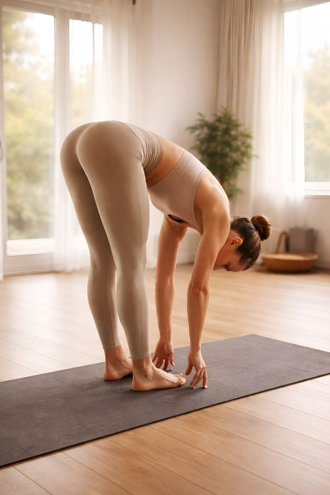

Modern life is rarely short of stress, and for many people, stress and poor sleep feed each other. A busy mind makes it hard to fall asleep, and a bad night makes the next day harder to handle. Yoga is one of the most popular tools people turn to for this problem, partly because it combines gentle movement, slow breathing and relaxation in one practice. It is not a cure for stress or insomnia, but research suggests it may help many people feel calmer and rest better.

This guide looks at what the evidence says, then gives you a practical evening routine, three breathing techniques, a step-by-step guide to Yoga Nidra (a guided relaxation practice) and a list of everyday habits that support better sleep. It also explains when it is time to talk to a doctor.

## What research says about yoga, stress and sleep

The U.S. National Center for Complementary and Integrative Health (NCCIH) summarizes the picture this way:

- Studies suggest yoga may help with stress management, mental and emotional health, sleep and balance
- A 2020 review of 12 studies with 672 healthy adults found beneficial effects of different types of yoga on perceived stress in all the studies
- Yoga can be a helpful addition to treatment for depression, and it may help with anxiety symptoms in a range of populations, though there is little evidence of a benefit for people with anxiety disorders
- A 2018 review of 8 studies (319 participants) with anxiety found evidence that yoga might have short-term benefits in reducing anxiety intensity
- Evidence for post-traumatic stress disorder (PTSD) is of low quality, though yoga might have benefits

The NCCIH also stresses that research quality varies and that, "in most instances, we can only say that yoga has shown promise for particular health uses, not that it's been proven to help." In plain terms: yoga is a reasonable, low-risk practice to try for stress and sleep, but it should not replace medical or psychological care when you need it.

## Why a calming practice might help

No single mechanism has been proven, but these ideas are commonly discussed:

- **Slow breathing** may help shift your body away from a state of high alert
- **Gentle movement** releases physical tension that builds up during the day
- **Attention training.** Focusing on breath and sensation gives the mind something to settle on, away from repeating thoughts
- **Routine.** A regular wind-down habit signals to your body that bedtime is approaching

Treat these as reasonable explanations, not guarantees.

## A gentle evening routine (25 minutes)

Do this 30 to 60 minutes before bed, in dim light. Wear comfortable clothing and keep a blanket nearby.

1. **Constructive rest (2 minutes).** Lie on your back with your knees bent and feet on the floor. Breathe slowly and notice your body against the mat
2. **Cat-Cow (2 minutes).** On hands and knees, move slowly with your breath
3. **Child's pose (3 minutes).** Rest your forehead on the floor or a cushion
4. **Low lunge or seated side stretch (2 minutes per side).** Choose gentle stretches that feel good and do not push
5. **Seated forward fold with bent knees (2 minutes).** Rest your arms on your legs or a pillow
6. **Supine twist (2 minutes per side).** Let gravity do the work
7. **Legs up the wall (5 minutes).** Rest with your legs supported against a wall, if comfortable
8. **Savasana (5 minutes or more).** Lie flat with your eyes closed, covered with a blanket

Avoid intense, heating practices late in the evening, as they may leave you feeling energized.

## Three calming breathing techniques

Always practice gently. If you feel dizzy, return to normal breathing.

### 1. Extended exhale

Breathe in through your nose for a count of four, then breathe out slowly for a count of six. Repeat for two to five minutes. Keep the breath smooth, with no straining.

### 2. Belly breathing in bed

Lie on your back and rest one hand on your belly. Inhale slowly so that the belly rises, then exhale and feel it fall. Continue for several minutes. If your mind wanders, return to the feeling of the hand rising and falling.

### 3. Humming bee breath (Bhramari)

Inhale through your nose, then exhale with a soft humming sound with your lips closed. Repeat five to eight times. The vibration can be soothing, and the longer exhale encourages slow breathing.

Avoid breath holding and fast breathing exercises before bed, particularly if you are a beginner.

## Yoga Nidra: guided deep relaxation

Yoga Nidra, often translated as "yogic sleep," is a guided relaxation practice done lying down. You remain awake, or in a state between wakefulness and sleep, while following spoken instructions that move your attention through the body and breath. It is often practiced with a recording or a teacher.

Research on Yoga Nidra specifically is smaller and less consistent than research on yoga as a whole, so it is best viewed as a relaxation technique, not a treatment. Many people find it restful.

### A simple Yoga Nidra practice (15 to 20 minutes)

1. **Settle.** Lie on your back in Savasana with a blanket over you and a pillow under your knees if needed. Close your eyes
2. **Set an intention (optional).** Choose a short, positive phrase such as "I am allowing myself to rest." Repeat it silently three times
3. **Body scan.** Slowly move your attention through your body: right hand, fingers, wrist, forearm, elbow, upper arm, shoulder, then the left side, then legs, torso, back, neck, face and head. Simply notice each area, without trying to change it
4. **Breath awareness.** Follow your natural breath, perhaps counting backward from 20 to 1 as you exhale
5. **Opposites (optional).** Briefly recall sensations such as heaviness and lightness, warmth and coolness
6. **Return.** Gently deepen your breath, wiggle your fingers and toes, roll to one side and slowly sit up

You can find guided recordings from qualified teachers. Choose one with a calm voice and clear instructions.

## Daytime stress relief: five-minute options

You do not need a full practice to benefit from some of these ideas.

- **Desk stretch.** Sit tall, roll your shoulders, gently stretch your neck from side to side and take five slow breaths
- **Standing forward fold.** With bent knees, let your head and arms hang for 5 to 10 breaths
- **Mountain pose.** Stand, feel your feet on the floor and breathe slowly for one minute
- **Walking meditation.** Walk slowly and notice each step, or step outside for a short walk
- **Three-part breath.** Take a slow breath into your belly, ribs and chest, then exhale slowly

## A simple four-week plan

If you like structure, this plan builds the habit gradually without overwhelming you. Adjust it to fit your schedule, and skip or repeat weeks as needed.

- **Week 1: breathing only.** Each evening, spend three minutes on extended exhale breathing, sitting or lying in bed. Notice how your body feels afterward, and write a single line in a notebook
- **Week 2: add movement.** Keep the breathing, and add the first four poses of the evening routine (constructive rest, Cat-Cow, Child's pose and a gentle stretch), about ten minutes in total
- **Week 3: full routine.** Practice the whole 25-minute evening sequence three or four times this week, finishing with Savasana
- **Week 4: add Yoga Nidra.** Replace Savasana with a guided Yoga Nidra recording two or three times, and keep a short note about how quickly you felt relaxed and how you slept

At the end of the month, look back at your notes. Which part helped you most? Was there a time of day that worked better? Keep what works and drop what does not. If your sleep or stress has not improved at all, or has become worse, speak to a health professional, because other factors may be involved, and it is better to find out sooner.

## Everyday habits that support sleep

Yoga works best alongside basic sleep habits. Evidence-based sleep guidance commonly includes:

- **Keep a regular schedule,** with consistent bed and wake times
- **Create a dark, quiet, cool bedroom**
- **Limit caffeine,** especially in the afternoon and evening
- **Avoid heavy meals and alcohol close to bedtime**
- **Reduce screens** before bed, or dim them and avoid stimulating content
- **Get daylight and movement** during the day
- **Use the bed for sleep,** not for work
- **If you cannot sleep after about 20 minutes,** get up, do something calm in dim light, and return when sleepy

## When to see a doctor

Yoga is not a substitute for medical care. Speak to a health professional if:

- You have trouble sleeping most nights for more than a few weeks
- You snore loudly, stop breathing, or wake gasping (possible signs of sleep apnea)
- You feel persistently sad, anxious, hopeless or overwhelmed
- Stress is affecting your work, relationships or physical health
- You have thoughts of harming yourself. In that case, seek help immediately by contacting local emergency services or a crisis line

The NCCIH notes that there is little evidence of yoga benefit for people with anxiety disorders, so professional support matters when anxiety is severe.

## Safety notes for yoga practice

The NCCIH says yoga is generally safe for healthy people when practiced appropriately, but injuries can occur. For an evening practice, keep movements gentle and avoid forcing stretches. Check with a health care provider if you are pregnant, or have conditions such as high blood pressure, glaucoma, sciatica or arthritis, which MedlinePlus lists among situations where some poses should be avoided or modified. Poses where the head is lower than the heart or legs are raised may not suit everyone, so take care and stop if you feel unwell.

## Common mistakes

- **Practicing too intensely late at night,** leaving you energized instead of calm
- **Using yoga as a performance.** Rest-focused practice is not about achieving shapes
- **Checking your phone** during relaxation
- **Expecting a quick fix.** Benefits, if any, usually build over weeks
- **Ignoring other factors** such as caffeine, light and schedule
- **Pushing through if relaxation practices make you anxious.** Some people feel uneasy with quiet and stillness. Keep your eyes open, shorten the session or talk to a professional

## Frequently asked questions

**How soon will I sleep better?** It varies. Some people feel calmer after one session, while others need several weeks. Many factors affect sleep.

**Is it okay to fall asleep during Yoga Nidra or Savasana?** At home, yes. If you want to stay awake, practice earlier in the day.

**What if I cannot stay still?** Start with gentle movement, such as Cat-Cow and slow stretches, before lying still. Short rests are fine.

**Can children practice these techniques?** The NCCIH notes that preliminary evidence suggests yoga may reduce anxiety and depression in children and teens, though more research is needed. Keep practices short and playful, and consult a health professional if you have concerns.

## Final thoughts

Yoga offers a gentle way to slow down at the end of the day. A short routine, a few slow breaths and a quiet body scan will not solve every sleep problem, but they can become a dependable ritual that tells your body it is safe to rest. Start small, stay consistent and seek help when you need more than self-care.

## Sources and further reading

- National Center for Complementary and Integrative Health (NCCIH), [Yoga: Effectiveness and Safety](https://www.nccih.nih.gov/health/yoga-effectiveness-and-safety)
- NCCIH, [Yoga: What You Need To Know](https://www.nccih.nih.gov/health/yoga-what-you-need-to-know)
- NCCIH, [5 Things You Should Know About Yoga](https://www.nccih.nih.gov/health/tips/yoga?nav=cd)
- MedlinePlus, [Yoga](https://medlineplus.gov/ency/patientinstructions/000876.htm)

This article is general information, not medical advice. Consult a qualified professional about your health and your practice.
